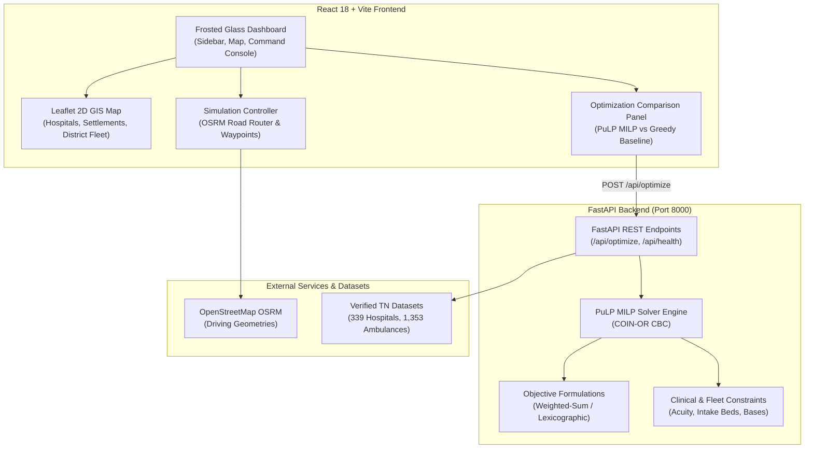

# PALS: Emergency Rescue & Operations Optimisation OS (Tamil Nadu)

<div align="center">


-1E293B?style=for-the-badge&logo=python&logoColor=white)


**An intelligent Operations Research and Geographic Information System (GIS) command dashboard for emergency medical logistics, multi-depot fleet dispatch, and acuity-based hospital allocation across the State of Tamil Nadu.**

[Features](#-key-capabilities) • [Mathematical Model](#-mathematical-formulation) • [Architecture](#-system-architecture) • [Quickstart](#-quickstart--installation) • [Verification Suite](#-testing--validation)

---

</div>

> ⚠️ **Academic Research & Technical Demonstration Prototype**  
> PALS pairs verified Tamil Nadu public health and administrative ambulance datasets with clearly labeled scenario simulation models. It is designed for operations research validation and algorithmic dispatch planning, not live emergency dispatch.

---

## 🌟 Key Capabilities

### Cardiac Arrest Response Simulation

Open **Cardiac Arrest** in the sidebar to report a suspected cardiac arrest, review extracted caller information, and coordinate synthetic ALS ambulances, AEDs and community responders. The module reuses the existing PuLP solver and hospital profiles. It includes persisted incidents, access-hour filtering, resource reservations across simultaneous cardiac scenarios, a Leaflet response map, independent resource events, explicit CPR/AED-use simulation, disruption controls and controlled A/B/C milestone comparisons.

All AEDs, responders and notifications are fictional. Hospital capability and capacity fields are scenario assumptions. The cardiac reservation registry is separate from the stateless experiments in the original Scenario Simulator. No clinical outcomes or survival benefits are predicted.

The cardiac workspace now uses every mapped hospital as a mock resource site: **339 hospital AEDs and 678 hospital ambulances (1 ALS + 1 BLS per site)**, in addition to the original demonstrations (**347 AED records and 690 ambulances total**). Each hospital also has six synthetic receiving places and a cardiac-only mock capability profile. The map offers independent clustered AED/fleet layers and statewide browsing. Discovery starts at 25 km; the solver can allocate from the entire statewide mock fleet. Hospital-origin ambulances can deliver their site's mock AED. Saved runs keep their original assignments; create a new report to exercise the expanded network.

**Run locally on Windows (two PowerShell terminals):**

```powershell
python -m venv .venv
.\.venv\Scripts\python.exe -m pip install -r backend\requirements-dev.txt
.\.venv\Scripts\python.exe -m uvicorn app.main:app --app-dir backend --host 127.0.0.1 --port 8000
```

```powershell
npm ci
npm run dev
```

Open [the local dashboard](http://127.0.0.1:5173/) and select **Cardiac Arrest → Create simulation report → Save review (optional) → Dispatch simulation resources → Play**. The report clock uses IST; change it to exercise AED opening hours. Use **New report** to create another incident while the first retains its reservations. Cancel or complete simulations to release resources.

Run the original and cardiac tests with:

```powershell
$env:PYTHONPATH = 'backend'
.\.venv\Scripts\python.exe -m unittest discover -s backend\app\tests -p 'test_*.py' -v
npm run build
```

Incident data persists under `backend/.simulation/` and is excluded from Git. Override `CARDIAC_DB_PATH` to isolate demo runs. Optional Gemini extraction requires both `GEMINI_API_KEY` and `GEMINI_MODEL` in the backend environment; this sends the synthetic caller description to Google's API. With either unset, deterministic extraction is used. No AI key is needed for the demo. See [integration contracts and assumptions](docs/cardiac-arrest-integration.md).

### 1. 🗺️ Tamil Nadu 2D Spatial GIS Engine
- **339 Mapped Hospital Nodes**: Real geographic coordinates categorised into Medical College Hospitals (MCH), District Headquarter Hospitals (DHQH), and Sub-District Hospitals (SDH).
- **2,391 Settlement Coordinates**: Indexed village-level centroids retained for spatial accessibility screening.
- **38 District Fleet Totals**: Plots verified district ambulance fleet aggregates (1,353 vehicles total across Tamil Nadu).
- **Hospital Access Vulnerability Gaps**: Highlights communities located beyond the 25 km threshold from mapped emergency facilities.
- **Marker Clustering & Independent Layer Toggles**: High-performance clustering for dense hospital and settlement data with zero tile lag.

### 2. ⚡ Operations Research MILP Solver (Python + PuLP)
- **Mathematical Multi-Depot Optimization**: Solves dispatch assignments using Mixed-Integer Linear Programming (MILP) solved via COIN-OR CBC.
- **Multi-Incident Contention Resolution**: Optimally allocates shared regional ambulances and hospital bed capacities when multiple catastrophic incidents occur simultaneously.
- **Patient Acuity Segregation**:
  - *Critical Patients*: Prioritised for Advanced Life Support (ALS) units and routed strictly to Level-1 / Comprehensive Trauma MCH facilities.
  - *Non-Critical Patients*: Transported via Basic Life Support (BLS) units to secondary Emergency Departments (ED).
- **Two Solver Objective Formulations**:
  - `weighted_sum`: Minimises patient-weighted response time, hospital transport time, and unserved casualty penalties.
  - `lexicographic`: Strictly guarantees zero unserved casualties first before minimising network transit time.
- **Mathematical Integrity Guarantee**: PALS strictly reports solver errors if the backend is unavailable and will **never** silently fall back to approximate or fabricated JavaScript heuristics.

### 3. 🚑 Real Road Routing & Dynamic Mission Simulation
- **OpenStreetMap OSRM Driving Router**: Real-time road routing over Tamil Nadu highway corridors (NH-45, NH-544, NH-44, etc.).
- **Circuity-Aware Fallback**: Straight-line estimation (1.35x road circuity factor at 50 km/h) if OSRM is offline or times out.
- **Two-Leg Mission Lifecycle**:
  - *Leg 1*: Ambulance Origin Base $\rightarrow$ Incident Scene (Triage & Casualty Boarding).
  - *Leg 2*: Incident Scene $\rightarrow$ Acuity-Assigned Hospital (Admission & Intake Handover).
- **Animated Map Interpolation**: Live vehicle position interpolation following genuine road geometries with phase indicators and time-warp speed controls (1x, 2x, 5x, 10x).

### 4. 📊 Side-by-Side Solver vs Greedy Baseline Audit
- Real-time comparison between the **PuLP MILP Solver** and a **Greedy Nearest-Suitable** heuristic.
- Quantifies fleet response vehicle-minutes, patient-minutes, unserved casualties, and net percentage improvements.

### 5. 🎨 Frosted Glassmorphism Command UI
- Dark graphite aviation aesthetics combined with warm ivory workspaces (`#FBF9F5` / `#171A1D` / `#D9531E`).
- Translucent backdrop blur (`backdrop-blur-xl`) with optical light refraction and specular border highlights.
- Global React Error Boundary preventing UI crashes during network or rendering anomalies.

---

## 🏛️ System Architecture



---

## 📐 Mathematical Formulation

### Sets and Indices
- $i \in I$: Emergency incidents (e.g., Highway crashes, railway accidents).
- $k \in K$: Ambulance depots/bases across Tamil Nadu.
- $m \in M$: Ambulance types ($\text{ALS}$, $\text{BLS}$).
- $j \in J$: Hospital facilities.

### Decision Variables
- $x_{ikm} \in \mathbb{Z}_{\ge 0}$: Count of type-$m$ ambulances dispatched from base $k$ to incident $i$.
- $y_{ij}^{\text{crit}} \in \mathbb{Z}_{\ge 0}$: Critical patients transported from incident $i$ to hospital $j$.
- $y_{ij}^{\text{noncrit}} \in \mathbb{Z}_{\ge 0}$: Non-critical patients transported from incident $i$ to hospital $j$.
- $u_i^{\text{crit}}, u_i^{\text{noncrit}} \in \mathbb{Z}_{\ge 0}$: Unserved casualties by acuity.

### Objective Function (Weighted-Sum)
$$\min \quad \alpha \sum_{i} \sum_{k} \sum_{m} t_{ik} \cdot x_{ikm} \;+\; \beta \sum_{i} \sum_{j} \tau_{ij} \left( y_{ij}^{\text{crit}} + y_{ij}^{\text{noncrit}} \right) \;+\; M \sum_{i} \left( u_i^{\text{crit}} + u_i^{\text{noncrit}} \right)$$

Where:
- $t_{ik}$: Travel time from base $k$ to incident $i$.
- $\tau_{ij}$: Transport time from incident $i$ to hospital $j$.
- $M$: High penalty constant ($10,000$) to prioritize serving all casualties before minimizing transit time.

### Key Constraints
1. **Fleet Availability**: $\sum_{i} x_{ikm} \le A_{km} \quad \forall k, m$
2. **Critical Patient ALS Requirement**: $\sum_{k} c_{\text{ALS}} \cdot x_{ik,\text{ALS}} \ge C_i - u_i^{\text{crit}} \quad \forall i$
3. **Total Patient Transport Capacity**: $\sum_{k} \sum_{m} c_m \cdot x_{ikm} \ge (C_i + N_i) - (u_i^{\text{crit}} + u_i^{\text{noncrit}}) \quad \forall i$
4. **Hospital Trauma Eligibility**: $y_{ij}^{\text{crit}} = 0 \quad \text{if hospital } j \text{ lacks verified Trauma/ICU capability}$
5. **Hospital Intake Bed Capacity**: $\sum_{i} (y_{ij}^{\text{crit}} + y_{ij}^{\text{noncrit}}) \le B_j \quad \forall j$

---

## 📁 Repository Structure

```
ERO TN/
├── backend/
│   ├── app/
│   │   ├── main.py                     # FastAPI entry point & CORS configuration
│   │   ├── models/schemas.py           # Pydantic validation schemas
│   │   ├── optimization/
│   │   │   ├── solver.py               # PuLP MILP solver & greedy baseline
│   │   │   ├── objective.py            # Objective formulation functions
│   │   │   └── constraints.py          # Mathematical constraint builders
│   │   ├── services/data_loader.py     # Preset hotspot definitions & discovery
│   │   └── tests/
│   │       ├── test_optimization.py    # 14 unit & regression tests
│   │       └── test_frontend_to_backend_e2e.py # 6 E2E integration tests
│   └── requirements.txt                # Python backend dependencies
├── src/
│   ├── components/
│   │   ├── Sidebar.jsx                 # Frosted glassmorphism navigation sidebar
│   │   ├── TopNav.jsx                  # Header with search, clock & IST timestamp
│   │   ├── GisMap.jsx                  # Leaflet 2D GIS map with layer clustering
│   │   ├── ScenarioSimulator.jsx       # 6-step interactive emergency simulation
│   │   ├── OptimizationComparisonPanel.jsx # Side-by-side solver vs baseline
│   │   ├── OptimisationResultsView.jsx # Live MILP solver execution workbench
│   │   ├── ErrorBoundary.jsx           # Global rendering error boundary
│   │   └── ...                         # Analytics, fleet, and hospital tables
│   ├── data/
│   │   ├── scenarioData.js             # Hotspots, scenario bases & fleet data
│   │   ├── hospitalCapabilityProfiles.js # Level-1 trauma & bed capacity profiles
│   │   └── mockData.js                 # 339 hospital facilities & district fleet
│   ├── services/
│   │   ├── optimizationService.js      # FastAPI solver integration service
│   │   └── routingService.js           # OSRM road router & curved fallbacks
│   ├── App.jsx                         # Workspace layout & navigation router
│   └── main.jsx                        # React root mount
├── package.json                        # Node scripts & dependencies
├── vite.config.js                      # Vite config with /api proxy to port 8000
└── tailwind.config.js                  # Custom graphite/ivory/burnt palette
```

---

## 🚀 Quickstart & Installation

### Prerequisites
- **Node.js** (v18 or higher)
- **Python** (v3.11 or higher)
- **pip** package manager

### 1. Clone the Repository
```bash
git clone https://github.com/samjoel4567/ERO-TN.git
cd ERO-TN
```

### 2. Backend Setup (FastAPI + PuLP)
```bash
# Navigate to backend and install requirements
pip install -r backend/requirements.txt

# Start the Python FastAPI backend server on port 8000
npm run backend
# Or directly:
# python3 -m uvicorn app.main:app --app-dir backend --host 127.0.0.1 --port 8000
```
Backend health check is accessible at `http://127.0.0.1:8000/api/health`.

### 3. Frontend Setup (React + Vite)
In a new terminal window:
```bash
# Install frontend dependencies
npm install

# Start Vite development server
npm run dev
```
Open [http://localhost:5173](http://localhost:5173) in your browser.

---

## 🧪 Testing & Validation

The optimization engine includes an extensive automated test suite covering edge cases, resource contention, and end-to-end integration across all 5 benchmark presets:

```bash
# Run the 14-test unit & regression suite
PYTHONPATH=backend python3 -m unittest -v backend/app/tests/test_optimization.py

# Run the 6-test frontend-to-backend E2E integration suite
PYTHONPATH=backend python3 -m unittest -v backend/app/tests/test_frontend_to_backend_e2e.py
```

### Verified Benchmark Scenarios
| Scenario ID | Location | Casualties (Crit / Non-Crit) | Solver Outcome |
| :--- | :--- | :--- | :--- |
| `HOTSPOT-01` | NH-45 Tambaram Bypass (Chennai) | 6 (2 Crit, 4 Non-Crit) | **100% Served** via ALS & Chromepet GH |
| `HOTSPOT-02` | Avinashi Road Express Flyover (CBE) | 4 (1 Crit, 3 Non-Crit) | **100% Served** via Coimbatore MCH |
| `HOTSPOT-03` | Madurai Outer Ring Road | 5 (2 Crit, 3 Non-Crit) | **100% Served** via Madurai GRH |
| `HOTSPOT-04` | Katpadi Railway Junction (Vellore) | 14 (4 Crit, 10 Non-Crit) | **4 Unserved Non-Crit** (intake bed limits correctly enforced) |
| `HOTSPOT-05` | Thiruvannamalai Girivalam Pathway | 9 (2 Crit, 7 Non-Crit) | **3 Unserved Non-Crit** (regional bed limits correctly enforced) |
| `CONTENTION` | Simultaneous `HOTSPOT-01` + `04` | 20 total casualties | **23.36% fleet response time reduction** over greedy baseline |

---

## 📜 Academic Attribution & License

- **Project Lead**: Sam Joel Raj ([@samjoel4567](https://github.com/samjoel4567))
- **Study Jurisdiction**: State of Tamil Nadu, India.
- **Routing Data**: OpenStreetMap contributors via Project OSRM.
- **Mathematical Optimization**: PuLP / COIN-OR CBC.
- **License**: MIT License.
